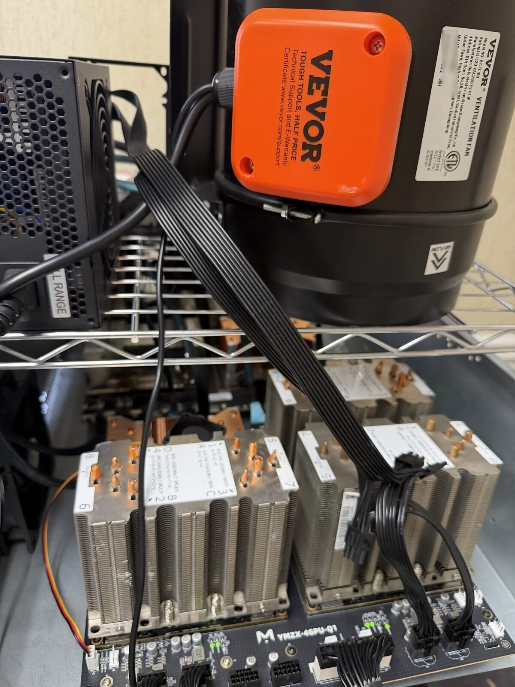

# The hardware list

The parts for one four-card Tesla V100 SXM2 board with NVLink, the host it plugs into, what changes when two or
three boards share that host, and [how to put it together](#how-to-build-it). The [builds](builds.md) run on these
parts.

Read this first:

- **Prices are rough used-market figures from 2026, and they move.** Used V100 cards more than doubled during the
  year ([below](#what-it-costs)).
- **Every part has a link.** Where a listing of the exact part was still up on November 18, 2026, it is linked,
  with a search for the same words beside it. Listings end, so the other parts have the search alone. None is an
  endorsement, and none is an affiliate link.
- **This is used datacenter hardware with no warranty.** The last section is the list of what went wrong.

<p></p>

*A four-card SXM2 board from above. Each of the four blocks is one V100-SXM2-32GB module under its heatsink.*

## How it goes together

A V100-**SXM2** is not a PCIe card. It is a bare module that bolts flat onto a socket, the way a CPU does, and it
has no fan of its own. Three kinds of part make it usable:

1. **A baseboard** with SXM2 sockets. The board carries NVLink between its sockets, power connectors, and one
   SlimSAS (SFF-8654 8i) port per card that carries that card's PCIe link.
2. **A PCIe switch card** in the host, with SlimSAS ports. Cables run from the switch card to the baseboard.
3. **A heatsink per card and moving air.**

The facts the builds depend on (from their public hardware sections):

- **Four cards per board, NVLink inside the board only.** Two boards do not share NVLink; they reach each other
  through the host over PCIe. This is why every build runs tensor parallelism inside a board and one pipeline stage
  per board ([front page, part 3](index.md#part-3-how-it-was-made-to-work-under-1cat-vllm)).
- **The cards are PCIe 3.0 devices**, and on the four-card board each card links at x8.

<p></p>

*The host. The green cards are PCIe switch cards; the braided cables are SlimSAS runs to the GPU boards. (The large
card behind them is an RTX 3090, not part of the V100 boards.)*

## The parts

### One four-card board

| Qty | Part | What it is for | Roughly | Links |
|---|---|---|---|---|
| 4 | **Tesla V100 SXM2 32GB** module. The same module is sold under several part numbers: 699-2G503-0203-220, 699-2G503-0280-200, 699-2G503-0204-200, 900-2G503-0010-000 | The GPU: 32 GB each, 128 GB a board | $450 to $700 each during 2026; about $900 by November | [search](https://www.ebay.com/sch/i.html?_nkw=NVIDIA+Tesla+V100+SXM2+32GB) |
| 4 | SXM2 heatsink, aluminium or copper, 6 to 11 cm high | One per module. Many cards are sold with one fitted; then you need none. A lower heatsink needs more air | $40 to $100 each | [aluminium, 11 cm](https://www.ebay.com/itm/406626697395) · [copper pipes, 9 cm](https://www.ebay.com/itm/358376572892) · [search](https://www.ebay.com/sch/i.html?_nkw=NVIDIA+Tesla+Heatsink+V100+SXM2) |
| 1 | Thermal paste, rated for bare dies | Between each module and its heatsink, for a card sold without a heatsink or one you re-seat | - | [search](https://www.ebay.com/sch/i.html?_nkw=thermal+paste+GPU+bare+die) |
| 1 | **Four-card SXM2 NVLink baseboard**, sold as "V100 4-card Quad-GPU SXM2 300G NVLINK 300GB/s Interconnection Baseboard Solution" (silkscreen `YMZX-4GPU-Q1` on ours) | Four SXM2 sockets with NVLink between all four cards; one SlimSAS port per card to the host; PCIe 8-pin power connectors along the edge | $800 to $900 | [listing](https://www.ebay.com/itm/298083941971) · [search](https://www.ebay.com/sch/i.html?_nkw=V100+4-card+Quad-GPU+SXM2+NVLINK+Baseboard) |
| 1 or 2 | **PCIe switch card**, x16 to four SlimSAS (SFF-8654 8i) ports: PLX8749 / PEX8749, PCIe 3.0 | Brings the cards' PCIe links into one x16 slot of the host. One switch card can carry a whole board. The eight-card builds use two per board, with two GPUs on each | $125 to $220 each; the higher price is a kit with four cables | [search](https://www.ebay.com/sch/i.html?_nkw=PLX8749+PCI+Express+x16+to+4x+SFF-8654+8I+Adapter) |
| 4 | SlimSAS cable, SFF-8654 8i to SFF-8654 8i, 74-pin | One per card, from the switch card to the baseboard | about $45; a switch-card kit includes four | [search](https://www.ebay.com/sch/i.html?_nkw=Slimline+SAS+4.0+SFF-8654+8i+74pin+cable) |
| 1 | Power supply with enough PCIe 8-pin leads for the board. The builds use 2,000 W units sold for mining rigs | Feeds the board's 8-pin connectors | about $75 | [search](https://www.ebay.com/sch/i.html?_nkw=2000W+PSU+Mining+Power+Supply+PCI-E+cables) |
| as needed | 8-pin to 6+2-pin PCIe power cables | Extra runs to the board | about $65 for two | [listing](https://www.ebay.com/itm/285446612373) · [search](https://www.ebay.com/sch/i.html?_nkw=8-Pin+to+6%2B2pin+PCI-E+Power+Cable) |
| 1 | Moving air: an inline duct fan or a large blower above the board, or a 4U server chassis with front fans | SXM2 modules have no fans ([cooling options](#cooling-options)) | about $310 for a 4U chassis with fans | [duct fan search](https://www.ebay.com/sch/i.html?_nkw=inline+duct+fan+6+inch) · [chassis listing](https://www.ebay.com/itm/146386072740) · [chassis search](https://www.ebay.com/sch/i.html?_nkw=4U+Rackmount+Server+Chassis+RSV-R4000U) |
| 1 | A mount: an open-air mining frame for 6 to 8 GPUs, or the 4U chassis | Holds the board and lets air reach the heatsinks | $35 to $75 for a frame | [search](https://www.ebay.com/sch/i.html?_nkw=Open+Air+Mining+Rig+Frame+8+GPU) |

Buy the **32 GB** card. A 16 GB SXM2 card looks the same and costs less; every build here needs 32 GB per card. Buy
the SXM2 module, not the PCIe version of the V100: the PCIe card does not fit these boards.

<p></p>

*A four-card board in use: the heatsinks, the power connectors along the board's edge, and above it the inline duct
fan that cools it.*

### The host

One host serves every board.

| Qty | Part | What it is for | Roughly | Links |
|---|---|---|---|---|
| 1 | CPU and board with a free PCIe x16 slot for every switch card. The eight-card builds use an AMD Threadripper PRO 3945WX (12 cores) on a Gigabyte MC62-G40 (WRX80, seven slots) | Runs the server; every card's PCIe link ends here | about $150 for the CPU and $530 for the board | CPU: [search](https://www.ebay.com/sch/i.html?_nkw=Threadripper+Pro+3945WX). Board: [search](https://www.ebay.com/sch/i.html?_nkw=Gigabyte+MC62-G40+WRX80) |
| 256 GB or more | DDR4 ECC registered memory | The model's lookup tables live in host RAM (110 GB for this model). A build that keeps weights in host RAM needs far more | varies with the market | [search](https://www.ebay.com/sch/i.html?_nkw=128GB+DDR4+2666+ECC+RDIMM+3DS) |
| 1 | The host's own ATX power supply | Powers the board, the CPU and the switch cards | - | [search](https://www.ebay.com/sch/i.html?_nkw=ATX+power+supply+1000W+80+Plus) |
| 1 | A drive with room for the model files. They are large: the published package of one eight-card build is 556 GB | Holds the model. A slow drive only makes loading slower | - | [search](https://www.ebay.com/sch/i.html?_nkw=2TB+NVMe+SSD) |
| as needed | Power strips rated for the load | Part of the build: a failed power strip has taken the host down | - | [search](https://www.ebay.com/sch/i.html?_nkw=heavy+duty+power+strip+15A) |

What the host needs: one x16 slot per switch card; enough ECC memory; and stable memory. On the eight-card host a
memory channel threw uncorrected ECC errors at DDR4-3200 until the speed was lowered.

### Two boards, or three

- **Eight cards:** the board list twice, on one host. The eight-card builds use four PLX8749 switch cards, two GPUs
  on each, every switch card in its own x16 slot. What that is worth, measured on the eight-card build: moving one
  switch card so that every switch had its own x16 slot gave about 2 % on long-prompt first token and nothing on
  decode
  ([source](https://github.com/ProprietaryLegal/Volta-sPLIt-DeepSeek-V4.1-Flash-1017-8xV100-SXM2-PP2xTP4#hardware)).
- **Twelve cards:** the board list three times. On the twelve-card server two boards sit behind one **PLX88096**
  (PCIe 4.0) switch card, x16 to ten SlimSAS ports, about $530
  ([listing](https://www.ebay.com/itm/820323407368) · [search](https://www.ebay.com/sch/i.html?_nkw=PLX88096+PCIe+4.0+x16+SlimSAS+SFF-8654+Switch+Adapter)); the
  third board sits behind one PLX8749.

<p></p>

*Copper heatsinks (top) and aluminium ones (bottom) on two boards. Both kinds are in use here.*

### Power to plan for

Measured on the builds: at a 150 W cap per card, eight cards drew about 965 W in decode and 458 W idle (about 57 W
a card doing nothing). The eight-card machine was built on two ordinary office circuits with 2,800 W of supply.

Set a power cap and a clock cap on every card, and make both survive a reboot. The builds run at 150 to 200 W per
card with clocks capped a little under the hardware maximum of 1,530 MHz. Two findings: "Clock caps matter more
than power caps on these cards", and decode does not care about the power cap (200 W in place of 150 W measured
neutral on eight cards and under 2 % on twelve), while prompt reading does (+13.7 % on twelve cards).

## How to build it

In the founder's words: "Setting it up was almost plug and play, even on windows, and for certain on linux"
([comment](https://www.reddit.com/r/LocalLLaMA/comments/1tnn29i/update_on_12x32gb_sxm_v100_cluster_local_ai_for/ooeoc93/)).
The steps below are for one board; repeat steps 1, 2, 4 and 5 for each further board.

**1. Put the modules on the board.** A module that came without a heatsink gets thermal paste and a heatsink first.
Then bolt each module flat onto one of the baseboard's four SXM2 sockets.

**2. Mount the board and give it air.** Fix the board to the frame or in the chassis, with the blower above it
blowing down through the heatsinks, or the chassis fans pushing air through them. Do not run a load without the air
moving: the modules have no fans.

**3. Put the switch cards in the host.** Each switch card goes in an x16 slot of its own. One switch card can carry
a board; the eight-card builds use two per board.

**4. Cable the board to the host.** One SlimSAS cable per GPU, from that card's port on the baseboard to a port on a
switch card. With two switch cards per board, two GPUs go to each.

**5. Connect power.** Run PCIe 8-pin leads from the board's power supply to the connectors along the board's edge.
Look at every connector first, and again after the machine has run: one of these boards was found with a burn mark on its power connection. Budget 200 W
per card at peak, so 800 W a board, on top of the host. With more than one board, spread the supplies over separate
circuits: the eight-card machine was built with two supplies on two office circuits.

**6. Install Linux and the NVIDIA driver.** The builds run Ubuntu 24.04. Use a driver from the **R580** branch, the
last that supports these cards.

**7. Check every card before loading a model.**

```bash
nvidia-smi -L                 # every card is listed
nvidia-smi topo -m            # which cards share a board
nvidia-smi nvlink -s          # every NVLink link is up
nvidia-smi --query-gpu=index,pcie.link.gen.current,pcie.link.width.current --format=csv
sudo journalctl -k | grep -i xid    # no Xid errors
```

Each card should link to the host at PCIe generation 3, width x8. Read the link under load: an idle card drops its
link speed. A card at x4 needs reseating. The full check list, with the power budget and the
error counters, is the hardware phase of the
[PLI Volta Builder skill](https://github.com/ProprietaryLegal/pli-volta-builder/blob/main/skills/pli-volta-builder/references/phases/00b-hardware.md).

**8. Cap power and clocks, at every boot.** Neither setting survives a reboot, so run them from a boot-time service.

```bash
sudo nvidia-smi -pm 1           # persistence mode
sudo nvidia-smi -pl 150         # power cap in watts, per card
sudo nvidia-smi -lgc 0,1522     # graphics clock cap in MHz
```

These are the eight-card builds' values. See [Power to plan for](#power-to-plan-for) for what each cap changes.
Uncapped clocks caused host resets under load ([what goes wrong](#what-goes-wrong)).

**9. Install the serving engine and a build.** The builds run on [1Cat-vLLM](https://github.com/1CatAI/1Cat-vLLM), a
fork of vLLM with kernels for these cards. Each build's repository has a "Reproduce" section with its patches,
weights, configuration and start command:

- [Volta sPLIt, eight cards](https://github.com/ProprietaryLegal/Volta-sPLIt-DeepSeek-V4.1-Flash-1017-8xV100-SXM2-PP2xTP4#reproduce)
- [Volta Max uPLIft, eight cards](https://github.com/ProprietaryLegal/Volta-Max-uPLIft-FP4-DeepSeek-V4.1-Flash-1017-NVFP4-8xV100-SXM2-PP2xTP4#reproduce)
- [every build](builds.md)

Each board is one pipeline stage, with tensor parallelism across its four cards. The order in which the start
command names the cards matters; each build's page gives it.

**10. Probe the speed after every boot.** One boot here read prompts 40 to 55 % slower with identical output and no
explained cause. A ten-second speed check before you trust a boot catches it.

To build and tune a different model on these cards, the [PLI Volta Builder skill](https://github.com/ProprietaryLegal/pli-volta-builder)
runs the same process in order: layout, first light, tests, and one measured change at a time.

## Cooling options

SXM2 modules have no fans. The heatsink does nothing without air pushed through it.

| Option | What it is | Used in the builds |
|---|---|---|
| **A blower over an open board** | A large fan or an inline duct fan above the board, blowing down through the heatsinks | Yes: the photo above shows an inline duct fan on a wire shelf over a four-card board |
| **A server chassis** | A closed 4U case with front fans pushing air through the heatsinks, as the cards were designed for | Yes |
| **Per-card fan shrouds** | A printed or moulded shroud that holds a small fan on one heatsink ([listing](https://www.ebay.com/itm/286347348707) · [search](https://www.ebay.com/sch/i.html?_nkw=Tesla+V100+SXM2+cooling+fan+shroud)) | Little. They work one card at a time |
| **A fan zip-tied on** | A case fan fixed to a heatsink ([50 mm fans, listing](https://www.ebay.com/itm/284450799934)) | As a patch only |

Open boards under a blower take a shelf each, and the heat goes into the room. Blowers and server fans are loud;
we have no noise measurement. Plan for a room nobody sits in.

<p></p>

*Heatsinks on a board under the shelf above it. Air has to get through these fins.*

## What it costs

| What | Roughly | Source |
|---|---|---|
| One four-card board with its cards, heatsinks, switch card and cables | $2,400 at early-2026 prices | [the founder's post](https://www.reddit.com/r/LocalLLaMA/comments/1rql2f3/4_32_gb_sxm_v100s_nvlinked_on_a_board_best_budget/) |
| The eight-card machine | $5,000 at early-2026 prices; $9,000 to $10,000 at November 2026 prices | [the founder's estimate](https://www.reddit.com/r/homelab/comments/1xusbar/lawyers_v100_homelab_update_2_the_8x_v100_box_now/19sn8jhhqo59f/) |
| One used V100 SXM2 32GB card in November 2026 | about $900, "more than double the roughly $400 apiece" of early 2026 | [Tom's Hardware](https://www.tomshardware.com/tech-industry/artificial-intelligence/lawyer-builds-private-ai-server-with-eight-used-nvidia-v100-gpus-up-to-215-tokens-per-second-to-keep-legal-files-offline-costing-about-usd2-400-per-four-gpu-board) |
| Electricity | about $80 a month at $0.16 per kWh | [the founder's comment](https://www.reddit.com/r/homelab/comments/1xusbar/lawyers_v100_homelab_update_2_the_8x_v100_box_now/19sqv44s2drj7/) |

## What goes wrong

From the founder's posts ([November 5](https://www.reddit.com/r/homelab/comments/1xoumr9/lawyers_v100_homelab_update_two_4card_sxm2_nvlink/),
[November 12](https://www.reddit.com/r/homelab/comments/1xusbar/lawyers_v100_homelab_update_2_the_8x_v100_box_now/))
and the builds' pages:

| What | What happened | What fixed it |
|---|---|---|
| **A burnt power connector** | "One GPU board's power connection had a burn mark. That board came out of the box. Check your connectors, people." | The board was pulled |
| **Host resets under load** | Two resets left firmware records of a fatal PCIe error at the root port feeding one board, with a higher power limit and uncapped clocks; cards drew 192 to 232 W against a 180 W limit | Capping the clocks. "Clock caps matter more than power caps on these cards" |
| **A fault that looked like PCIe and was probably power** | A faster prompt-reading path "stopped the host or a card three times out of three. Firmware logged PCIe errors, so I spent days suspecting slots, switch cards and cables. Then I changed the power delivery. I think it was one bad PSU in the chain." | After the change, nine of nine long chats read clean. The cause is not proven |
| **Memory errors** | "One memory channel threw four uncorrected ECC errors, three of them while loading the model, which killed two worker processes." | Memory speed lowered from DDR4-3200 to DDR4-2666; the counters have stayed clean |
| **A card linked at half width** | "One GPU linked at x4 instead of x8 the last time I checked, with zero replays." | Reseating it was the plan |
| **A slower boot after a memory change** | "Adding RAM changed how the BIOS lays out memory, and one boot that day read prompts 40 to 55 % slower with identical output." | Not explained. "Every boot now gets a 10 second speed probe before I trust it." |
| **A transfer that hangs** | On the host with 1 TB of RAM, a direct transfer between two cards behind one PCIe host bridge hangs | The two pipeline stages pair their cards across bridges ([source](https://github.com/ProprietaryLegal/Volta-Max-uPLIft-FP4-DeepSeek-V4.1-Flash-1017-NVFP4-8xV100-SXM2-PP2xTP4#hardware)) |
| **Supplies tripping under load** | In October 2026, with twelve cards on the supplies and circuits then available, power supplies tripped under full load | A standing rule until the wiring changed: full load on no more than eight cards at once, and at most two requests per board; raised to three after other equipment was moved off the circuit |
| **All twelve cards dropping off the bus** | Under load in October 2026 | Lower caps: 190 W per card and a 1,395 MHz clock cap, later 175 W, then 150 W |
| **A failed power strip** | It dropped the host | Replaced. Power strips are part of the build |
| **An NVLink fault** | An NVLink error (Xid 74) took two cards out of service in September 2026 | The cards were drained and the build moved to other boards |
| **A BIOS tuning test that changed nothing** | A fenced test of BIOS settings for speed (2026-11-13): no difference; a memory remap did not give a single NUMA node | Every setting put back to Auto |
| **Card errors during a bad software test** | Four cards logged an Xid 43 error during one test of a faulty engine change on the twelve-card build | The engine fix; the cards were not at fault |

## The drawbacks, in one list

- **Power and heat.** About a kilowatt for eight cards while working, 458 W idle; a room of its own.
- **Noise.** Unmeasured, and not small.
- **No fans, no case, no warranty.** You are building the cooling and the mounting yourself.
- **The used market.** Prices more than doubled in 2026. Parts arrive untested, and one board had a burnt connector.
- **Old silicon.** FP16 tensor cores only; no FP8 or FP4. Every modern low-bit format is unpacked in software
  ([front page, part 2](index.md#part-2-how-it-compares-with-newer-chips)).
- **Topology.** NVLink only inside a board of four. Everything larger crosses PCIe 3.0 and must be laid out for it.
- **Software on borrowed time.** NVIDIA's R580 driver branch is the last to support Volta; CUDA 13 dropped it from
  the compiler; PyTorch keeps it only in CUDA 12.6 builds. You will pin versions and run a community fork.
- **Memory that the headline hides.** "don't just read the 32gb headline number and thing it's totally equivalent
  to a GPU with newer architecture"
  ([comment](https://www.reddit.com/r/LocalLLaMA/comments/1tnn29i/update_on_12x32gb_sxm_v100_cluster_local_ai_for/ooeoc93/)):
  some memory-saving features of newer cards do not exist here.

What the cards give in return is on the [front page](index.md#part-8-the-hardware-what-it-costs-and-what-it-gives)
and in [builds.md](builds.md).
