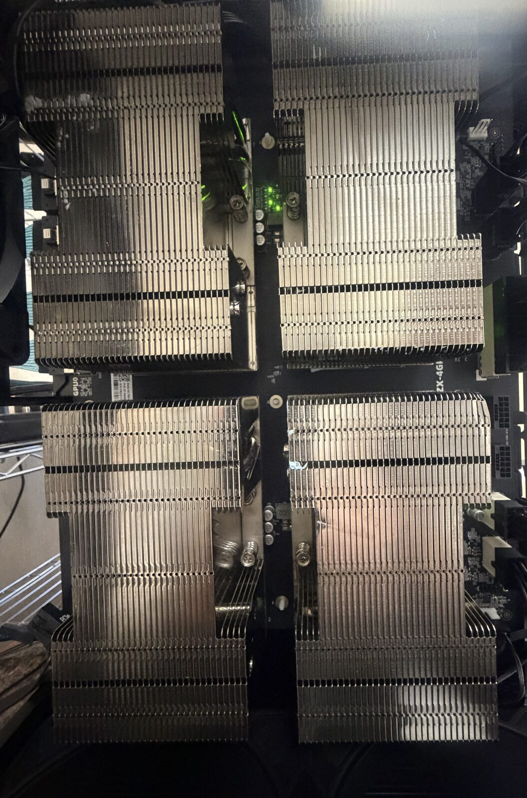
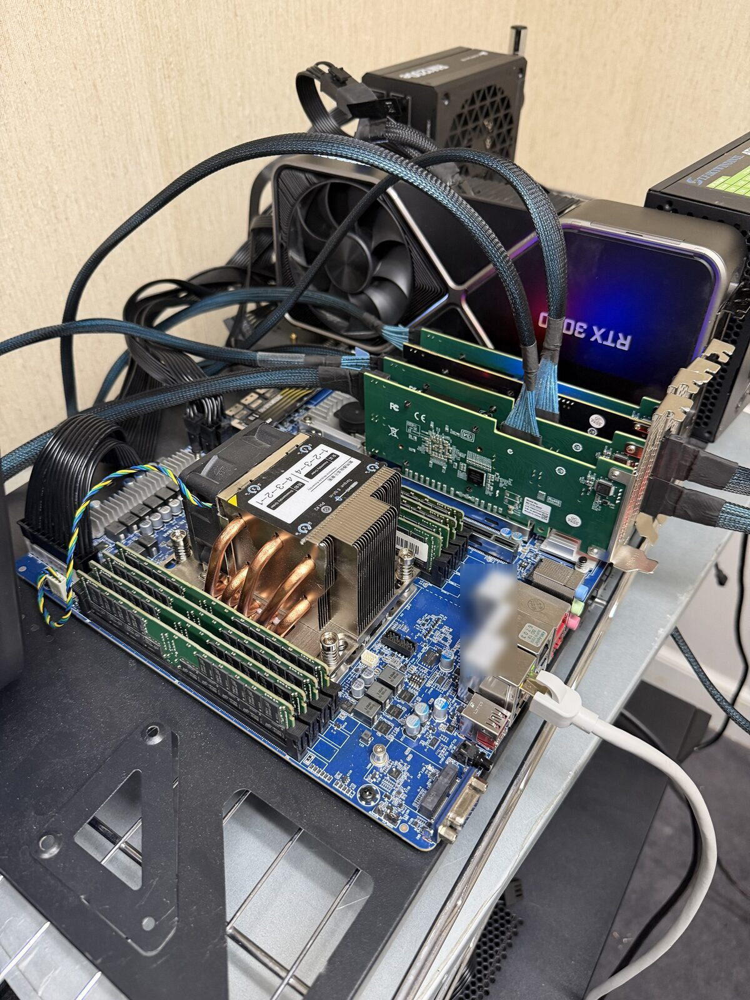
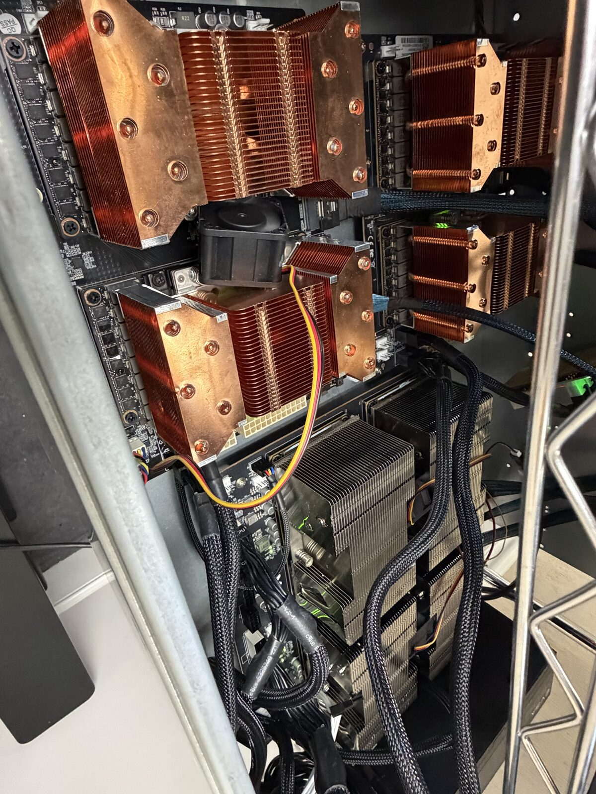
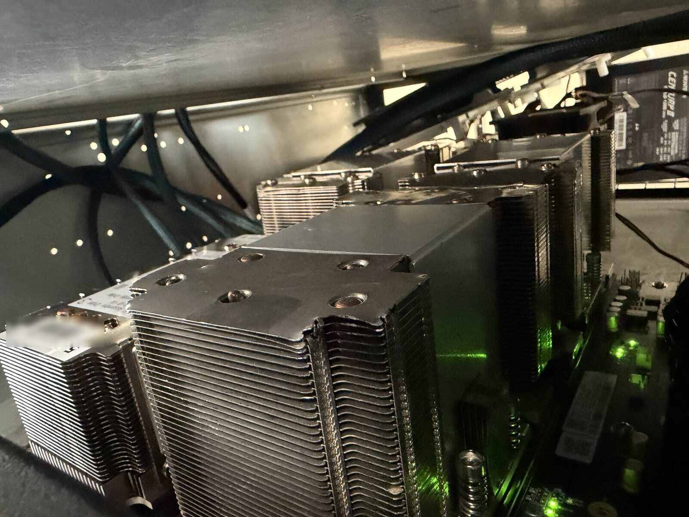

# The hardware list

What to buy to build a four-card Tesla V100 SXM2 board with NVLink, and how to chain two or three of them to one
host. Every part below is one PLI Labs' founder bought in 2026 for the machines the [builds](builds.md) run on, with
what it is for, what was paid and when, and a link.

Read this first:

- **Prices are order totals from 2026 and they move.** Used V100 cards more than doubled during the year
  ([below](#what-it-cost-and-what-it-costs-now)). Treat every figure as "paid, month and year", not as a quote.
- **Listings end.** Each part has the listing it was bought from and a search link for the same words. Neither is an
  endorsement of a seller, and none is an affiliate link.
- **This is used datacenter hardware with no warranty.** The last section is the list of what went wrong.

*A four-card SXM2 board from above. Each of the four blocks is one V100-SXM2-32GB module under its heatsink.*

## How it goes together

A V100-**SXM2** is not a PCIe card. It is a bare module that bolts flat onto a socket, the way a CPU does, and it
has no fan of its own. Three kinds of part make it usable:

1. **A baseboard** with SXM2 sockets. The board carries NVLink between its sockets, power connectors, and one
   SlimSAS (SFF-8654 8i) port per card that carries that card's PCIe link.
2. **A PCIe switch card** in the host, with SlimSAS ports. Cables run from the switch card to the baseboard.
3. **A heatsink per card and moving air.**

The facts the builds depend on (from their public hardware sections):

- **Four cards per board, NVLink inside the board only.** Two boards do not share NVLink; they reach each other
  through the host over PCIe. This is why every build runs tensor parallelism inside a board and one pipeline stage
  per board ([front page, part 3](index.md#part-3-how-it-was-made-to-work-under-1cat-vllm)).
- **The cards are PCIe 3.0 devices**, and on the four-card board each card links at x8.
- **Eight cards:** two boards, four PLX8749-class (PCIe 3.0) switch cards, two cards per switch at Gen3 x8, each
  switch on its own x16 slot.
- **Twelve cards:** three boards. Two boards sit behind one PLX88096 (PCIe 4.0) switch card, the third behind a
  PLX8749 (PCIe 3.0) card.

*The host. The green cards are PCIe switch cards; the braided cables are SlimSAS runs to the GPU boards. (The large
card behind them is an RTX 3090, not part of the V100 boards.)*

## The parts

### The cards

| Part | What it is for | Paid, when | Listing | Search |
|---|---|---|---|---|
| Tesla V100 SXM2 32GB, part number 699-2G503-0203-220, with heatsink | the GPU: 32 GB of HBM2 | $454.35 (March 2026); $486.00 (March 2026) | [item](https://www.ebay.com/itm/336412326832) | [search](https://www.ebay.com/sch/i.html?_nkw=Tesla+V100+SXM2+32GB+699-2G503-0203-220) |
| Tesla V100 SXM2 32GB, 699-2G503-0280-200 | the same card, another part number | $486.00 (March 2026, two orders) | [item](https://www.ebay.com/itm/306835224789) | [search](https://www.ebay.com/sch/i.html?_nkw=Tesla+V100+SXM2+32GB+699-2G503-0280-200) |
| Tesla V100 SXM2 32GB, 699-2G503-0204-200, with copper heatsink | the same card with a copper heatsink | $489.65 (February 2026) | [item](https://www.ebay.com/itm/177859233468) | [search](https://www.ebay.com/sch/i.html?_nkw=Tesla+V100+SXM2+32GB+699-2G503-0204-200+copper+heatsink) |
| Tesla V100 SXM2 32GB, 900-2G503-0010-000, no heatsink, sold untested | the cheapest way in, at your risk | $311.79 (March 2026) | [item](https://www.ebay.com/itm/198131076380) | [search](https://www.ebay.com/sch/i.html?_nkw=Tesla+V100+SXM2+32GB+900-2G503-0010-000) |
| Tesla V100 SXM2 32GB | the same card six months later | $679.32 (September 2026) | [item](https://www.ebay.com/itm/306360401226) | [search](https://www.ebay.com/sch/i.html?_nkw=NVIDIA+Tesla+V100+SXM2+32GB) |

Buy the **32 GB** card. A 16 GB SXM2 card looks the same and costs less; every build here needs 32 GB per card.

### The boards

| Part | What it is for | Paid, when | Listing | Search |
|---|---|---|---|---|
| **Four-card SXM2 NVLink baseboard** ("V100 4-card Quad-GPU SXM2 300G NVLINK 300GB/s Interconnection Baseboard Solution"; silkscreen `YMZX-4GPU-Q1` on ours) | Four SXM2 sockets with NVLink between all four cards; one SlimSAS port per card to the host; PCIe 8-pin power connectors along the edge. This is the board every build here uses: 128 GB per board | $785.29 (March 2026); $882.12 (June 2026); $853.09 (September 2026); a fourth in June 2026 | [item](https://www.ebay.com/itm/298083941971) | [search](https://www.ebay.com/sch/i.html?_nkw=V100+4-card+Quad-GPU+SXM2+NVLINK+Baseboard) |
| Two-card SXM2 NVLink board ("V100 SXM2 300G NVlink interconnect Dual card SXM2 adapter board") | Two sockets with NVLink between them: 64 GB. Where the founder started | $243.95 (February 2026); $248.27 (March 2026) | [item 1](https://www.ebay.com/itm/136815411932), [item 2](https://www.ebay.com/itm/297819385835) | [search](https://www.ebay.com/sch/i.html?_nkw=V100+SXM2+NVlink+Dual+card+SXM2+adapter+board) |
| Single-card SXM2 to PCIe x16 adapter (it came bundled with a 16 GB card) | One socket, no NVLink. Useful only for testing a card | $388.54 with the card (February 2026) | [item](https://www.ebay.com/itm/136899727575) | [search](https://www.ebay.com/sch/i.html?_nkw=SXM2+to+PCI-E+x16+adapter+card+V100) |

*A four-card board in use: the heatsinks, the power connectors along the board's edge, and above it the inline duct
fan that cools it.*

In the founder's words, from [a post of March 2026](https://www.reddit.com/r/LocalLLaMA/comments/1rql2f3/4_32_gb_sxm_v100s_nvlinked_on_a_board_best_budget/):

> I feel like people don't understand how significant it is that these 4 cards are connected on the board via
> NVLink.

and from [a comment of May 2026](https://www.reddit.com/r/LocalLLaMA/comments/1tnn29i/update_on_12x32gb_sxm_v100_cluster_local_ai_for/ooeoc93/),
on the other way to buy:

> in the past month I saw an inspur server with 8 32gb v100s on ebay selling for either 5k or 6k. That is probably
> the ideal v100 setup becuase all 8 are nvlinked [...] The PCIE in between the 4 card boards is a very big
> bottleneck.

He did not buy one. Whether all eight cards of such a server share NVLink was his expectation, not something
measured here.

### The link to the host: switch cards and cables

| Part | What it is for | Paid, when | Listing | Search |
|---|---|---|---|---|
| PLX8749 (PCIe 3.0) x16 switch card to 4x SFF-8654 8i, sold with four baseplates and four cables | One x16 slot fans out to four SlimSAS ports. The kit that matches a four-card board | $221.27 (April 2026; again May 2026) | [item](https://www.ebay.com/itm/136933479189) | [search](https://www.ebay.com/sch/i.html?_nkw=PLX8749+PCI+Express+x16+to+4x+SFF-8654+8I+Adapter) |
| PLX8749 / PEX8749 expansion card with four SFF-8654 SlimSAS x8 ports | The switch card alone | $128.40 (March 2026, two); $126.24 (February 2026); $125.93 (April 2026) | [item 1](https://www.ebay.com/itm/146916627492), [item 2](https://www.ebay.com/itm/146727390215) | [search](https://www.ebay.com/sch/i.html?_nkw=PLX8749+PEX8749+Expansion+Card+SFF-8654+SlimSAS+x8) |
| PLX88096 (PCIe 4.0) x16 switch card to ten SlimSAS SFF-8654 ports | One slot for two boards. The twelve-card server has two boards behind one of these | $529.05 (November 2026) | [item](https://www.ebay.com/itm/820323407368) | [search](https://www.ebay.com/sch/i.html?_nkw=PLX88096+PCIe+4.0+x16+SlimSAS+SFF-8654+Switch+Adapter) |
| PCIe x16 to SlimSAS SFF-8654 8i adapter, sold as "2x PCI-E x8" with two baseplates and a cable | Two x8 SlimSAS links from one slot | $92.22 (March 2026) | [item](https://www.ebay.com/itm/147080403459) | [search](https://www.ebay.com/sch/i.html?_nkw=PCI+Express+x16+to+SlimSAS+SFF-8654+8I+Adapter) |
| SlimSAS cable, SFF-8654 8i to SFF-8654 8i, 74-pin | One per card, switch card to baseboard | $43.52 (March 2026) | [item](https://www.ebay.com/itm/287088139317) | [search](https://www.ebay.com/sch/i.html?_nkw=Slimline+SAS+4.0+SFF-8654+8i+74pin+cable) |

What the PCIe side is worth, measured on the eight-card build: moving one switch card so that every switch had its
own x16 slot gave about 2 % on long-prompt first token and nothing on decode
([source](https://github.com/ProprietaryLegal/Volta-sPLIt-DeepSeek-V4.1-Flash-1017-8xV100-SXM2-PP2xTP4#hardware)).
The founder's summary, from [a comment](https://www.reddit.com/r/homelab/comments/1xoumr9/lawyers_v100_homelab_update_two_4card_sxm2_nvlink/19s73lsd7uchs/):

> v100s are stuck at pcie3. 4 card board max out at x8. So 4 pcie3 pex cards are max throughput.

### Heatsinks and thermal paste

| Part | What it is for | Paid, when | Listing | Search |
|---|---|---|---|---|
| Heatsink for SXM2 V100, 6 cm high | A low heatsink for tight cases; it needs more air | $47.80 (April 2026) | [item](https://www.ebay.com/itm/267633716344) | [search](https://www.ebay.com/sch/i.html?_nkw=Heatsink+SXM2+GPU+Tesla+V100+6cm) |
| Heatsink for SXM2 V100, 11 cm high | A tall aluminium heatsink | $64.78 (February 2026) | [item](https://www.ebay.com/itm/406626697395) | [search](https://www.ebay.com/sch/i.html?_nkw=Heatsink+SXM2+GPU+Tesla+V100+11cm) |
| SXM2 heatsink, ten copper pipes, 9 cm high | A heat-pipe heatsink | $97.20 (May 2026) | [item](https://www.ebay.com/itm/358376572892) | [search](https://www.ebay.com/sch/i.html?_nkw=SXM2+V100+Heatsink+10+Copper+Pipes+9cm) |
| "NVIDIA Tesla Heatsink for V100 SXM2" | The server heatsink | $95.04 (February 2026) | [item](https://www.ebay.com/itm/267578097135) | [search](https://www.ebay.com/sch/i.html?_nkw=NVIDIA+Tesla+Heatsink+V100+SXM2) |
| Thermal paste | Between each module and its heatsink. A card bought without a heatsink, or re-seated, needs it | not in the 2026 orders; any paste rated for bare dies | - | - |

Many cards are sold with a heatsink already fitted; those are the easy ones.

*Copper heatsinks (top) and aluminium ones (bottom) on two boards. Both kinds are in use here.*

### Power

| Part | What it is for | Paid, when | Listing | Search |
|---|---|---|---|---|
| 2,000 W power supply with multiple PCIe cables (sold for mining rigs) | Feeds a board's 8-pin connectors | $72.87 (March 2026) | [item](https://www.ebay.com/itm/317913093741) | [search](https://www.ebay.com/sch/i.html?_nkw=2000W+PSU+Mining+Power+Supply+PCI-E+cables) |
| 8-pin to 6+2-pin PCIe power cables, two-pack | Extra runs to the boards | $64.77 (March 2026) | [item](https://www.ebay.com/itm/285446612373) | [search](https://www.ebay.com/sch/i.html?_nkw=EVGA+8-Pin+to+6%2B2pin+PCI-E+Power+Cable) |

Power caps tried over the year, from the builds' records: 245 W per card (July 2026); 190 W with a 1,395 MHz clock
cap, then 175 W (October); 180 W and 1,425 MHz (1 November); 150 W and 1,522 MHz (the eight-card measurements);
175 W (mid-November); 150 W and then 200 W with a 1,477 MHz cap on twelve cards. Two findings survive all of them:
"Clock caps matter more than power caps on these cards", and decode does not care about the power cap (200 W in
place of 150 W measured neutral on eight cards and under 2 % on twelve), while prompt reading does (+13.7 % on
twelve cards). Clocks are set a little under the hardware maximum of 1,530 MHz and the setting is made to survive
a reboot.

Budget, from the builds' own measurements: at a 150 W cap eight cards drew about 965 W in decode and 458 W idle
(about 57 W a card doing nothing). The eight-card machine was built on two ordinary office circuits with 2,800 W
of supply. One fault that looked like PCIe turned out, as far as could be told, to be one bad power supply in a
chain ([below](#what-goes-wrong)).

### Frames and a case

| Part | What it is for | Paid, when | Listing | Search |
|---|---|---|---|---|
| Open-air mining frame, 6 to 8 GPUs | An open frame to mount the host and the boards on, with air reaching the heatsinks from above | $33.30 and $74.16 (February 2026) | [item 1](https://www.ebay.com/itm/205872384163), [item 2](https://www.ebay.com/itm/335279448603) | [search](https://www.ebay.com/sch/i.html?_nkw=Open+Air+Mining+Rig+Frame+8+GPU) |
| 4U rackmount chassis with fans (RSV-R4000U) | The "server box": a closed case with its own front-to-back airflow | $311.05 (June 2026) | [item](https://www.ebay.com/itm/146386072740) | [search](https://www.ebay.com/sch/i.html?_nkw=4U+Rackmount+Server+Chassis+RSV-R4000U) |

### The host

The eight-card host is public in the builds' pages: an AMD Threadripper PRO 3945WX (12 cores) on a Gigabyte
Threadripper PRO workstation board, 251 GB of DDR4 at first and 1 TB since November 2026.

| Part | What it is for | Paid, when | Listing | Search |
|---|---|---|---|---|
| AMD Threadripper PRO 3945WX | The host CPU of the eight-card builds | $150.12 (March 2026) | [item](https://www.ebay.com/itm/335521397445) | [search](https://www.ebay.com/sch/i.html?_nkw=Threadripper+Pro+3945WX) |
| Gigabyte MC62-G40 (WRX80) workstation board | A Threadripper PRO board with room for four switch cards ("Threadripper has 7 slots", in the founder's words) | $527.04 (March 2026) | [item](https://www.ebay.com/itm/176709995609) | [search](https://www.ebay.com/sch/i.html?_nkw=Gigabyte+MC62-G40+WRX80) |
| AMD EPYC 7302P, 7402 (and a 7642 with a Gigabyte MZ32-AR0 board) | Server-class alternatives bought for other hosts | $103.68 (February 2026); $96.12 (June 2026) | [7302P](https://www.ebay.com/itm/396808505593), [7402](https://www.ebay.com/itm/256678857974) | [search](https://www.ebay.com/sch/i.html?_nkw=AMD+EPYC+7402) |
| H12D-8D board for EPYC 7002/7003 | Four PCIe 4.0 x16 slots | $494.64 (June 2026) | [item](https://www.ebay.com/itm/168308378107) | [search](https://www.ebay.com/sch/i.html?_nkw=H12D-8D+Motherboard+EPYC) |
| DDR4 ECC registered memory | The model's lookup tables live in host RAM (110 GB for this model), and a build that keeps weights in host RAM needs far more | 128 GB modules: $637.20 and $1,278.70 per order (November 2026) | [item](https://www.ebay.com/itm/820165092199) | [search](https://www.ebay.com/sch/i.html?_nkw=128GB+DDR4+2666+ECC+RDIMM+3DS) |

What the host needs: one x16 slot per switch card; enough ECC memory; and stable memory. On the eight-card host a
memory channel threw uncorrected ECC errors at DDR4-3200 until the speed was lowered.

## Cooling options

SXM2 modules have no fans. The heatsink does nothing without air pushed through it.

| Option | What it is | What we use |
|---|---|---|
| **A blower over an open board** | A large fan or an inline duct fan above the board, blowing down through the heatsinks | **Yes.** The photo above shows an inline ventilation duct fan on a wire shelf over a four-card board. In the founder's words: "I have a vertical metal tube air mover thing that just blows down into there. Have not had any overheating issues on those cards. The setup is not especially pretty but it works." ([comment, May 2026](https://www.reddit.com/r/LocalLLaMA/comments/1tnn29i/update_on_12x32gb_sxm_v100_cluster_local_ai_for/onv822a/)) |
| **A server chassis** | A closed 4U case with front fans pushing air through the heatsinks, as the cards were designed for | **Yes**, the "server box" in the list above |
| **Per-card fan shrouds** | A printed or moulded shroud that holds a small fan on one heatsink ([shroud, $42.10](https://www.ebay.com/itm/286347348707); [3U heatsink fan adapter, $31.64](https://www.ebay.com/itm/296950683730); [9 cm shroud with an 80 mm fan](https://www.ebay.com/itm/267284471098); [search](https://www.ebay.com/sch/i.html?_nkw=Tesla+V100+SXM2+cooling+fan+shroud)) | Bought, and **not much used.** They exist and they work one card at a time; the founder prefers the blower and the server box |
| **A fan zip-tied on** | A case fan fixed to a heatsink ([50 mm 12 V fans, five-pack, $51.82](https://www.ebay.com/itm/284450799934)) | As a patch. "You can just zip tie a fan to it and that gets the job done" ([comment, March 2026](https://www.reddit.com/r/homelab/comments/1rzg3eb/feedback_on_my_256gb_vram_local_setup_and_cluster/obm3tpi/)) |

What each costs you:

- **Space and heat.** Open boards under a blower take a shelf each, and the heat goes into the room. "they draw
  power. And throw off a lot of heat so they need their own room"
  ([comment, November 2026](https://www.reddit.com/r/LocalAIServers/comments/1xouorj/8x_v100sxm232gb_in_late_2026_doing_real_work/19s7ixfgfphya/)).
  With sixteen cards in one machine "the heat in that room was absurd"
  ([comment, October 2026](https://www.reddit.com/r/LocalLLaMA/comments/1xk20x5/lawyer_with_too_many_gpus_part_3_deepseekv41flash/19ry1nqtiytqb/)).
- **Noise.** We have no measurement and no public statement to quote. Blowers and server fans are loud; plan for a
  room nobody sits in.
- **More fans are not always the answer.** During one fault hunt: "I added fans. Temperatures did not care. Airflow
  was not the problem"
  ([post, November 2026](https://www.reddit.com/r/homelab/comments/1xusbar/lawyers_v100_homelab_update_2_the_8x_v100_box_now/)).

*Heatsinks on a board under the shelf above it. Air has to get through these fins.*

## What it cost, and what it costs now

| When | What the founder said it cost | Source |
|---|---|---|
| March 2026 | "Buy 4 32gb v100 sxm cards/heatsinks for 1600, get the aom sxm board and pex card for 750. That's 128gb of unified nvlink vram for 2400." | [post](https://www.reddit.com/r/LocalLLaMA/comments/1rql2f3/4_32_gb_sxm_v100s_nvlinked_on_a_board_best_budget/) |
| May 2026 | "you can often find 32gb sxm v100s for between 450 and 500 per gpu. Each 4 card chinese board, together with a PEX card, and 4 slim saas cables, you can usually get for about $800 via alibaba" | [comment](https://www.reddit.com/r/LocalLLaMA/comments/1tnn29i/update_on_12x32gb_sxm_v100_cluster_local_ai_for/ooeoc93/) |
| November 2026 | For the eight-card machine: "When I built it, about 5k. Maybe 450/v100, 800 per board. Now, probably 9-10k." | [comment](https://www.reddit.com/r/homelab/comments/1xusbar/lawyers_v100_homelab_update_2_the_8x_v100_box_now/19sn8jhhqo59f/) |
| November 2026 | Tom's Hardware: used cards "now listed on eBay for about $900, more than double the roughly $400 apiece from the post" | [article](https://www.tomshardware.com/tech-industry/artificial-intelligence/lawyer-builds-private-ai-server-with-eight-used-nvidia-v100-gpus-up-to-215-tokens-per-second-to-keep-legal-files-offline-costing-about-usd2-400-per-four-gpu-board) |

The order totals above agree: $454 to $490 a card in February and March 2026, $679 in September; $785 for a
four-card board in March, $853 to $882 from June. Running cost, in his words: "Abt $80/month in power"
([comment](https://www.reddit.com/r/homelab/comments/1xusbar/lawyers_v100_homelab_update_2_the_8x_v100_box_now/19sqv44s2drj7/)),
at $0.16 per kWh.

Two pieces of buying advice from the same threads:

- Buy a few cards at a time. "these I could buy 2-3 at a time [...] It was a lot easier to just buy a couple per
  month and scale up"
  ([comment](https://www.reddit.com/r/LocalLLaMA/comments/1tnn29i/update_on_12x32gb_sxm_v100_cluster_local_ai_for/oo2rv5s/)).
- Do not buy the PCIe version of the card for this. "I made the PCIe mistake. Have 2 of them. Fine to run small
  models on but the sxm2 cards are cheaper and faster"
  ([comment](https://www.reddit.com/r/LocalLLaMA/comments/1tnn29i/update_on_12x32gb_sxm_v100_cluster_local_ai_for/onvud9v/)).

And the honest counterweight, from the same comment as the first: "If i was starting over I guess maybe I would
have gotten two 80gb a100s and an nvlink to start [...] I am positive newer architecture is easier and runs
better."

## What goes wrong

From the founder's posts ([November 5](https://www.reddit.com/r/homelab/comments/1xoumr9/lawyers_v100_homelab_update_two_4card_sxm2_nvlink/),
[November 12](https://www.reddit.com/r/homelab/comments/1xusbar/lawyers_v100_homelab_update_2_the_8x_v100_box_now/))
and the builds' pages:

| What | What happened | What fixed it |
|---|---|---|
| **A burnt power connector** | "One GPU board's power connection had a burn mark. That board came out of the box. Check your connectors, people." | The board was pulled |
| **Host resets under load** | Two resets left firmware records of a fatal PCIe error at the root port feeding one board, with a higher power limit and uncapped clocks; cards drew 192 to 232 W against a 180 W limit | Capping the clocks. "Clock caps matter more than power caps on these cards" |
| **A fault that looked like PCIe and was probably power** | A faster prompt-reading path "stopped the host or a card three times out of three. Firmware logged PCIe errors, so I spent days suspecting slots, switch cards and cables. Then I changed the power delivery. I think it was one bad PSU in the chain." | After the change, nine of nine long chats read clean. The cause is not proven |
| **Memory errors** | "One memory channel threw four uncorrected ECC errors, three of them while loading the model, which killed two worker processes." | Memory speed lowered from DDR4-3200 to DDR4-2666; the counters have stayed clean |
| **A card linked at half width** | "One GPU linked at x4 instead of x8 the last time I checked, with zero replays." | Reseating it was the plan |
| **A slower boot after a memory change** | "Adding RAM changed how the BIOS lays out memory, and one boot that day read prompts 40 to 55 % slower with identical output." | Not explained. "Every boot now gets a 10 second speed probe before I trust it." |
| **A transfer that hangs** | On the host with 1 TB of RAM, a direct transfer between two cards behind one PCIe host bridge hangs | The two pipeline stages pair their cards across bridges ([source](https://github.com/ProprietaryLegal/Volta-Max-uPLIft-FP4-DeepSeek-V4.1-Flash-1017-NVFP4-8xV100-SXM2-PP2xTP4#hardware)) |
| **Supplies tripping under load** | In October 2026, with twelve cards on the supplies and circuits then available, power supplies tripped under full load | A standing rule until the wiring changed: full load on no more than eight cards at once, and at most two requests per board; raised to three after other equipment was moved off the circuit |
| **All twelve cards dropping off the bus** | Under load in October 2026 | Lower caps: 190 W per card and a 1,395 MHz clock cap, later 175 W, then 150 W |
| **A failed power strip** | It dropped the host | Replaced. Power strips are part of the build |
| **An NVLink fault** | An NVLink error (Xid 74) took two cards out of service in September 2026 | The cards were drained and the build moved to other boards |
| **A BIOS tuning test that changed nothing** | A fenced test of BIOS settings for speed (2026-11-13): no difference; a memory remap did not give a single NUMA node | Every setting put back to Auto |
| **Card errors during a bad software test** | Four cards logged an Xid 43 error during one test of a faulty engine change on the twelve-card build | The engine fix; the cards were not at fault |

## The drawbacks, in one list

- **Power and heat.** About a kilowatt for eight cards while working, 458 W idle; a room of its own.
- **Noise.** Unmeasured, and not small.
- **No fans, no case, no warranty.** You are building the cooling and the mounting yourself.
- **The used market.** Prices more than doubled in 2026. Parts arrive untested, and one board had a burnt connector.
- **Old silicon.** FP16 tensor cores only; no FP8 or FP4. Every modern low-bit format is unpacked in software
  ([front page, part 2](index.md#part-2-how-it-compares-with-newer-chips)).
- **Topology.** NVLink only inside a board of four. Everything larger crosses PCIe 3.0 and must be laid out for it.
- **Software on borrowed time.** NVIDIA's R580 driver branch is the last to support Volta; CUDA 13 dropped it from
  the compiler; PyTorch keeps it only in CUDA 12.6 builds. You will pin versions and run a community fork.
- **Memory that the headline hides.** "don't just read the 32gb headline number and thing it's totally equivalent
  to a GPU with newer architecture"
  ([comment](https://www.reddit.com/r/LocalLLaMA/comments/1tnn29i/update_on_12x32gb_sxm_v100_cluster_local_ai_for/ooeoc93/)):
  some memory-saving features of newer cards do not exist here.

What the cards give in return is on the [front page](index.md#part-8-the-hardware-what-it-costs-and-what-it-gives)
and in [builds.md](builds.md).
