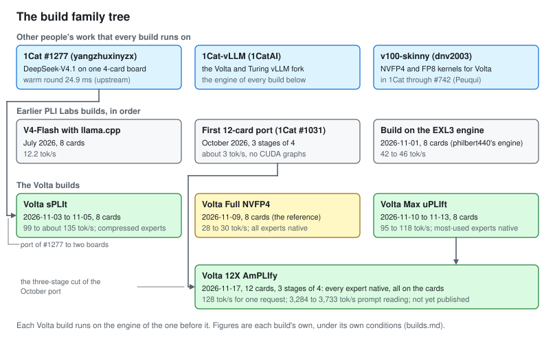
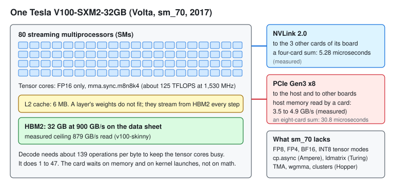
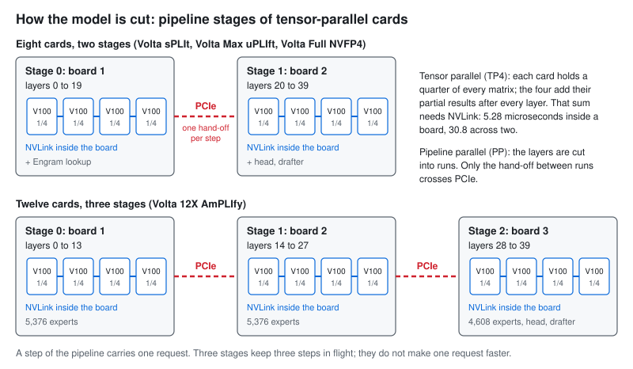
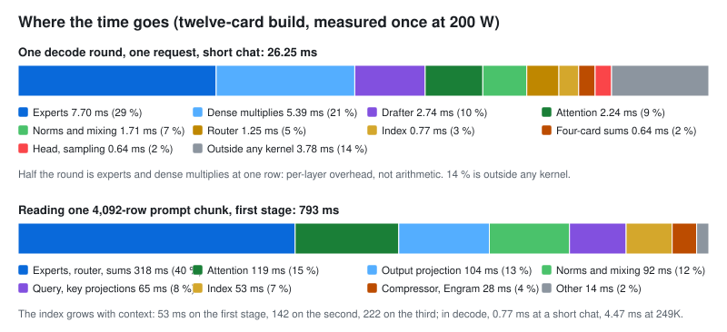

# A 2026 model on 2018 GPUs: everything we learned running DeepSeek-V4.1-Flash on Tesla V100s

Built by **Nick Mermiges, Esq.**, founder of [PLI Labs](https://proprietarylegal.ai/labs.html) · [proprietarylegal.ai](https://proprietarylegal.ai)

*Published 2026-11-18. This page is the front of PLI Labs' Volta research repository. Every number on it is labelled
MEASURED (on our hardware, with its conditions), UPSTREAM (someone else's, linked) or ESTIMATE (arithmetic), and
links to its source. The failures are told as plainly as the wins.*

## What you can use from this page

A Tesla V100 is a datacenter GPU from 2017. Four of them on an NVLink board hold 128 GB of fast memory and cost
about $2,400 used when we bought ours ([part 8](#part-8-the-hardware-what-it-costs-and-what-it-gives)). This page
is what seventeen days of work on eight and then twelve of them taught us, with DeepSeek-V4.1-Flash-1017, a
40-layer mixture-of-experts model:

- **It works, and it is fast enough to use.** On eight cards, MEASURED 2026-11-05: 215 tok/s writing code and 118
  tok/s writing legal text after a 1K prompt, 2,200 tok/s reading a 128K prompt, 524K tokens of context
  ([Volta sPLIt](builds.md#volta-split)).
- **Most of that speed is other people's work**, chiefly the [1Cat-vLLM](https://github.com/1CatAI/1Cat-vLLM) fork
  and the [v100-skinny](https://github.com/dnv2003/v100-skinny) kernels. [Part 3](#part-3-how-it-was-made-to-work-under-1cat-vllm)
  says who did what.
- **The card is never short of arithmetic when it writes. It is short of memory bandwidth and it loses time
  between kernels.** Every optimization that won follows from that ([part 1](#part-1-voltas-architecture)).
- **The largest gains were not kernels.** A cache that survives a changed reply (0.69 s in place of 31 s), one
  transport setting (-14 % to the first token), not re-sending a request's history every step (-25 % of a round
  at 128K).
- **More than thirty ideas lost**, some of them faster than what we kept. They are all listed with their numbers
  ([what did not work](optimizations/what-did-not-work.md)).
- **The method is the reusable part**: a rule written before its data, a reference measured in the same hour, and
  a judge that cannot be talked into a pass ([part 5](#part-5-the-whole-process-of-testing)).

The four builds, with links and headline numbers, are in [builds.md](builds.md). If you only want to know whether
an idea applies to your machine, go to the [decision table](method/decision-table.md).

## Part 1: Volta's architecture

The V100-SXM2-32GB is NVIDIA's Volta generation, compute capability 7.0, called `sm_70` by the compiler. Four
facts about it decide everything below.

**1. Its tensor cores do one thing.** Volta introduced tensor cores, and its only tensor instruction is
`mma.sync.m8n8k4`: half-precision (FP16) inputs, FP16 or FP32 accumulation. There is no FP8, FP4, BF16 or INT8
tensor path. Two helper instructions that every later fast kernel leans on are missing too: `ldmatrix` (Turing) and
`cp.async` (Ampere). Source: NVIDIA's [Volta tuning guide](https://docs.nvidia.com/cuda/volta-tuning-guide/index.html)
and the later guides for what was added. A kernel written for a newer chip does not port. Its idea might.

**2. Its memory is fast, and that is the number that matters.** 32 GB of HBM2 at 900 GB/s on the data sheet;
879 GB/s read, measured (UPSTREAM, [v100-skinny](https://github.com/dnv2003/v100-skinny)). The FP16 tensor cores
give about 125 TFLOPS at the full 1,530 MHz clock
([Volta whitepaper](https://images.nvidia.com/content/volta-architecture/pdf/volta-architecture-whitepaper.pdf)).
Divide one by the other: the card must do about 139 floating-point operations per byte it reads to keep its
tensor cores busy.

**3. Writing a token does almost no arithmetic per byte.** To write one token the model multiplies each weight
matrix by one row, or by six rows when a drafter proposes five tokens ahead. That is about 1 operation per byte
for FP16 weights and at most about 47 for 2-bit weights at six rows
([arithmetic](method/kernel-building.md#step-1-size-it-before-you-build-it)). All of it is far below 139. So in
decode the tensor cores wait. Time is bytes read divided by bandwidth, plus fixed costs: about 2,089 kernel
launches per round on the eight-card build, and the gaps between them (MEASURED by profile, 2026-11-03,
[research note](research/kernels/KERNEL-RESEARCH-CLAUDE-NOTES.md)). Reading a prompt is the opposite case:
thousands of rows at once, plenty of arithmetic per byte, and tensor-core kernels pay.

**4. The cards are joined by two very different wires.** Four cards share an SXM2 board with an NVLink 2.0 mesh.
Boards reach each other, and the host, only through PCIe Gen3. MEASURED on our machines: adding four cards'
partial results takes 5.28 microseconds inside a board and 30.8 across two boards
([source](https://github.com/ProprietaryLegal/Volta-sPLIt-DeepSeek-V4.1-Flash-1017-8xV100-SXM2-PP2xTP4/blob/main/docs/levers.md#did-not-work));
a card reads weights from host memory at 3.5 to 4.9 GB/s
([source](https://github.com/ProprietaryLegal/Volta-Full-NVFP4-DeepSeek-V4.1-Flash-8xV100#what-did-not-work-or-is-not-yet-good)),
about two hundred times slower than it reads its own.

The rule that follows: **tensor parallelism inside a board, pipeline parallelism across boards, and nothing a
round needs on the far side of PCIe.**

## Part 2: How it compares with newer chips

Each generation since added an instruction the previous one lacked. The table shows what was added and what it
means for a model stored in few bits.

| Generation | Tensor-core arithmetic | Data movement inside a kernel | Low-bit weights |
|---|---|---|---|
| **Volta** V100 (`sm_70`, 2017) | `mma.sync.m8n8k4`, FP16 only | by hand: global memory to registers to shared memory | none in hardware. Every format is unpacked in software into FP16 operands |
| Turing (`sm_75`) | larger FP16 tiles; INT8 and INT4 modes; `ldmatrix` | by hand | INT8, INT4 |
| Ampere A100, RTX 30 (`sm_80`, `sm_86`) | BF16, TF32, INT8; sparse modes | **`cp.async`**: asynchronous copies into shared memory | INT8; no FP8 or FP4 |
| Hopper H100 (`sm_90`) | warp-group multiplies (`wgmma`) fed from shared memory | **TMA** tile copies; thread-block clusters | **FP8** in the tensor cores |
| Blackwell B200 (`sm_100`) | `tcgen05` with its own accumulator memory | TMA | **FP8, FP6, FP4**, with block scaling (MXFP4, NVFP4) |
| DGX Spark GB10 (`sm_121`) | warp-level `mma.sync` with block-scaled FP4 and FP8; no `tcgen05` | - | FP4 and FP8 in hardware, on 128 GB of unified memory at **273 GB/s** |

Sources: NVIDIA's [Volta](https://docs.nvidia.com/cuda/volta-tuning-guide/index.html),
[Ampere](https://docs.nvidia.com/cuda/ampere-tuning-guide/index.html),
[Hopper](https://docs.nvidia.com/cuda/hopper-tuning-guide/index.html) and
[Blackwell](https://docs.nvidia.com/cuda/blackwell-tuning-guide/index.html) tuning guides and the
[DGX Spark hardware overview](https://docs.nvidia.com/dgx/dgx-spark/hardware.html); the full table with its
references is in [our kernel survey](research/kernels/KERNEL-RESEARCH-REPORT.md).

**What a 4-bit format buys on a card with no 4-bit tensor cores.** On Blackwell, NVFP4 weights go into the
tensor cores as they are. On Volta they cannot. A kernel reads the 4-bit codes, unpacks them in registers into
FP16, and multiplies with the one tensor instruction it has. The multiply is no faster. **The read is four times
smaller**, and decode is limited by the read. v100-skinny's NVFP4 kernel reaches 77 % of the measured read
ceiling at one row (UPSTREAM). So "NVFP4 cannot help on a V100" is wrong, and so is "fewer bits are always
faster": unpacking costs instructions per weight, not per bit. Our 2-bit expert kernels read at only 290 to 415
GB/s because they were limited by instructions issued, not by memory (MEASURED,
[Volta sPLIt](https://github.com/ProprietaryLegal/Volta-sPLIt-DeepSeek-V4.1-Flash-1017-8xV100-SXM2-PP2xTP4#hardware)).

**The comparison that surprised us.** One V100 has 3.3 times the memory bandwidth of a whole DGX Spark (900
against 273 GB/s, both published). The Spark has the modern instructions; the old card has the wider road. For a
task limited by bytes per second, eight-year-old HBM2 is not obsolete.

## Part 3: How it was made to work under 1Cat-vLLM

Upstream vLLM dropped Volta. [1Cat-vLLM](https://github.com/1CatAI/1Cat-vLLM), by 1CatAI, is the fork that kept
it: Volta kernels for quantized layers, a Volta attention backend, CUDA graphs on `sm_70`, speculative decoding,
pipeline parallelism. Everything on this page runs on it. The pieces, and whose they are:

| Piece | What it does | Whose |
|---|---|---|
| The DeepSeek-V4.1 package for one four-card board | The model on `sm_70`: its kernels, 512K of packed key-value storage, the launcher. A warm decode round of 24.9 ms (UPSTREAM) | yangzhuxinyzx, [#1277](https://github.com/1CatAI/1Cat-vLLM/pull/1277) |
| The QPN kernels for NVFP4 and FP8 | 4-bit and 8-bit weights unpacked into FP16 tensor-core operands, with no shared memory in the main loop | Dennis Vertzyas, [v100-skinny](https://github.com/dnv2003/v100-skinny); packaged into 1Cat by Peuqui, [#742](https://github.com/1CatAI/1Cat-vLLM/pull/742) |
| The speculative drafter (DSpark) | A small model proposes five tokens; the big model checks all five in one pass and keeps the ones it agrees with | DeepSeek's design; the 1Cat verifier by yangzhuxinyzx, [#274](https://github.com/1CatAI/1Cat-vLLM/pull/274) |
| The EXL3 engine for this model | EXL3 experts, attention inside CUDA graphs, the drafter, a 1M-token context. Our first eight-card build ran on it | rivetphilbot, [#1243](https://github.com/1CatAI/1Cat-vLLM/pull/1243); published by Phil Tompkins as [deepseek-v4.1-v100](https://github.com/philbert440/deepseek-v4.1-v100) |
| Synchronous scheduling | Turning asynchronous scheduling off gave +55 % decode on a two-stage V100 build (UPSTREAM) | zambalee, [issue #852](https://github.com/1CatAI/1Cat-vLLM/issues/852) |
| The first run of the official checkpoint on twelve and on eight V100s | Three stages of four, or two; the legal stage cuts. About 3 tok/s (UPSTREAM) | PLI Labs, [#1031](https://github.com/1CatAI/1Cat-vLLM/pull/1031) |
| The port of #1277 to two boards, and then to three | Below | PLI Labs |

**The layout.** The model has 40 layers. A board holds four cards in tensor parallel: each card has a quarter of
every matrix and the four add their partial results after every layer, over NVLink. That is one **stage**. The
layers are cut into two stages on eight cards, or three on twelve, and only the hand-off from one stage to the
next crosses PCIe.

Not every cut is legal. The model's sparse attention reads from a few "source" layers, and a stage must begin at
one. With the memory of a card as the second constraint, that leaves layer 20 for two stages and layers 14 and 28
for three.

**What the port was.** #1277 serves this model on one board by keeping a third of the experts in host memory. On
fresh text it then ran at 25 tok/s against 97 warm, because of the fetches (MEASURED on one of our boards,
[source](https://github.com/ProprietaryLegal/Volta-sPLIt-DeepSeek-V4.1-Flash-1017-8xV100-SXM2-PP2xTP4/blob/main/docs/four-card.md)).
Putting the second half of the model on a second board means no expert is ever fetched. That is Volta sPLIt:
99 tok/s on the day of the port, before any optimization, where our previous engine gave 42 to 46.

**Long context** comes from the model and the package: packed key-value storage with a ring of recent positions on
the cards and the rest in host memory; prompts read in chunks of 8,192 tokens; a prefix cache. We measured needle
retrieval at 450K and 498K tokens: 6 of 6 in 4 of 4 runs.

Every credit, with each pull request's author and state checked on 2026-11-18, is in [CREDITS.md](CREDITS.md).

## Part 4: Every optimization, build by build

One short table per build here; the full tables, with every loser, are linked from each heading. "Answers" says
whether the change can alter the model's output: *bitwise* (same bits), *near-tie* (may differ only where two
tokens were almost tied; gated), *rounding* (a different but equally valid rounding, judged by closeness) or
*changes* (it does, and the row says what was done about it).

### Volta sPLIt (eight cards, compressed experts) · [full table](optimizations/volta-split.md)

MEASURED 2026-11-03 to 11-05, 150 W per card, clock ceiling 1,522 MHz, milliseconds per verify round in mirrored
A/B arms. The plain port: 31.1 ms per round. The checkpoint: about 23.1 ms (ESTIMATE from the measured 23.2 to
23.4 and one further measured change).

| Optimization | Gave | Cost | Answers |
|---|---|---|---|
| Model Runner V2 (vLLM's newer runner, our port for this model) | **-2.76 ms per round** | 1.4 ms slower at one prompt length (32K), cause unknown | bitwise |
| Expert kernels: fast variants, then an "instruction diet" | -1.2 to -1.7 ms, then **-0.87 ms** | none | bitwise; the diet near-tie |
| Add the index only over the live context, not the maximum | -0.85 ms | none | exact |
| Keep the request in the batch across empty pipeline steps (port of Peuqui's [#1263](https://github.com/1CatAI/1Cat-vLLM/pull/1263)) | **-24.8 % of a round at 128K** | none | identical |
| Coupled sampled drafts (the idea is [TensorFold #25](https://github.com/Elevatormusic/TensorFold/pull/25)) | +14 % tok/s at temperature 1 | 0.3 ms per round | exact in distribution |
| Prefill skip: early prompt chunks skip layers they cannot reach | first token **-8.8 % at 32K, -31.5 % at 300K** | none | identical |
| Host hand-off between the boards (one NCCL setting) | first token **-13 to -14 %** | none | bitwise |
| Tiled and fused index scorers | decode -13.7 % at 300K; first token -9.5 % at 300K | none | bitwise; the fused one near-tie |
| Three chat slots, for their caches | chats taking turns: first token 20 to 49 s down to **0.6 to 0.9 s** | card memory | identical |
| *Lost:* fused prefill attention | first token -11.4 % | **not installed** | changes: a confident token moved |
| *Lost:* asynchronous scheduling; one tensor-parallel group of eight; 19 expert-kernel variants | +1.68 ms; 30.8 against 5.28 microseconds per sum; none faster | - | - |

### Volta Full NVFP4 (eight cards, every expert native, overflow in host RAM) · [full table](optimizations/volta-full-nvfp4.md)

MEASURED 2026-11-09, clock ceiling 1,522 MHz.

| Item | Result | Answers |
|---|---|---|
| Folding NVIDIA's NVFP4 pack to MXFP4 | 44,696,862,720 values bit-equal | exact |
| Experts split between the cards and host RAM | bit-equal to all on one card | exact |
| *Lost:* reading experts from host RAM in decode | about 975 microseconds per expert per layer; **28 to 30 tok/s** where Volta sPLIt gives 118 | - |

This build is the reference the others are compared with. Its lesson is the number in the last row.

### Volta Max uPLIft (eight cards, the most-used experts native) · [full table](optimizations/volta-max-uplift.md)

MEASURED 2026-11-09 to 11-13; the clock ceiling and power limit changed between test windows, so compare inside a
row.

| Optimization | Gave | Cost | Answers |
|---|---|---|---|
| Promote experts to native precision in order of use per byte, all on the cards | 6,087 of 15,360 experts native; 79 to 85 % of decode routes on them; 95.1 % same next token as the all-native reference, where Volta sPLIt has 92.2 % | decode slower than Volta sPLIt | rounding: closer to the reference, by a preregistered test |
| No host tier at all | general text 58 to 59 ms per round down to 33.4 | - | - |
| Group-plan kernel (one launch in place of a chain of tensor operations) | **-4.9 ms per round** | none | bitwise |
| Snapshot of the sliding-window state per slot | a follow-up after a changed reply: **0.69 s in place of 31 s** at 100K | 82 MB of host memory | identical to an ordinary cache hit |
| Prompt slots (two by default) | two together 1.33 times one stream; three 1.48 times | 267 to 553 fewer native experts; **quality not established** | identical to the same prompt alone |
| Fast prompt reading from compressed records | first read near 200K: 86 to 119 s where native reading took 155 to 165 s | **changes output from the first token; quality not established** | changes |
| *Lost:* a new decode kernel; 64 rows per weight load; a remote drafter | 0.000 ms predicted; slower; 42.6 ms per round against a 4.5 ms bar | - | - |

### Volta 12X AmPLIfy (twelve cards, every expert native, all on the cards) · [full table](optimizations/volta-12x-amplify.md)

MEASURED 2026-11-17 on a twelve-V100 server, 150 W per card unless the row says 200 W, clock ceiling 1,477 MHz.
The build's repository is not yet published; these figures come from its private working record.

| Change | Gave | Cost | Answers |
|---|---|---|---|
| A third pipeline stage on the fast engine | every expert native on the cards; first divergence from the all-native reference after a median of 208 tokens, where the eight-card build diverges after 7 | one request is no faster than on eight cards (128 tok/s) | rounding: closer |
| Scheduler spacing for three stages | without it **15 of 15 answers were wrong** | none | it is a correctness fix |
| Prompt chunks of 4,092 rows | room for a third and fourth slot | reading 4 % slower | rounding |
| Four slots | four chats kept warm; three together 288 tok/s summed, where the eight-card build gave 198 | a fourth request adds only 6 %: a pipeline step carries one request | identical |
| 200 W in place of 150 W | prompt reading +13.7 % (3,284 to 3,733 tok/s) | power; decode unchanged | none |
| Release the allocator's cache only above the chunk size | reading **+12.6 % at 61K, +9.9 % at 93K** (200 W, one run) | none found | identical |
| *Lost:* one stage on eight cards with no pipeline | one request -3 %, three at once -41 %, long reads -26 % | - | - |

### Earlier builds · [full page](optimizations/earlier-builds.md)

DeepSeek-V4-Flash with llama.cpp (July 2026) found a silent corruption with quantized key caches and that fourteen
cards in a layer split are half as fast as eight. The first twelve-card port (October) found the legal cuts and ran
at 3 tok/s. The EXL3 engine build (1 November) found that keeping the Engram tables in RAM cut a cold first token
from 46 to 27 s.

## Part 5: The whole process of testing

The full method, as a reusable document, is [method/testing.md](method/testing.md). In brief:

1. **A rule is written before its data.** The arms, the figure that decides, the noise floor, and what counts as
   accept, as no measurable change, and as inconclusive. It is time-stamped and not edited afterwards.
2. **Predictions are recorded and scored.** A wrong prediction stays in the record as wrong.
3. **INCONCLUSIVE is never a pass.** "Could not check" and "found nothing wrong" are different results.
4. **The unit is the verify round**, not tokens per second, because tokens per second moves with the text.
5. **Mirrored arms and a measured noise floor.** OFF, ON, ON, OFF, each arm a fresh boot; the same configuration
   measured against itself sets the floor.
6. **A fenced window on a machine that also serves.** The serving build stops; the reference boots *in the same
   window*; one change per boot; the serving build is restored and checked.
7. **Two judges.** The identity judge (token ids equal to a same-window reference) for changes that claim the same
   arithmetic. The closeness judge (same next token, KL divergence, changed multiple-choice answers, against a
   reference that is itself run twice) for changes that alter rounding. Identity cannot show answers are good.
   Closeness cannot show closeness to the original model if the reference is a quantization.
8. **Checks run on real logs before a window.**

**What went wrong.** These are the most useful paragraphs on the page.

- *Our own checks spoiled test arms five times on one build.* A pattern for out-of-memory lines matched the
  memory limit's own announcement and refused a good boot. A worker count was doubled by a new log line. A witness
  read a process environment that the engine blanks. A probe replayed answers without their reasoning and measured
  cold reads. A witness failed a boot on a harmless warning. Each had passed its own tests. None had been run
  against a real log of the boot it would judge.
- *The equality judge accepted cut-off answers.* It compared two answers only as far as the shorter one. Removing
  a token from each of twelve references still printed "identical 12 of 12".
- *A cache returned wrong tokens after an edit.* A token cache under construction returned wrong ids on a hit when
  an edit removed the special token at its cut. Its check compared token counts, which matched.
- *Isolated kernel benchmarks were wrong in both directions.* One predicted 0.03 ms for a change that gave 0.42.
- *A cached answer is not a cold answer.* On the unmodified engine, a reply after a cache hit can differ from a
  cold read of the same prompt at near-tied tokens. A test that assumes otherwise fails correct code.
- *A sum is not a rate.* "Four requests: 306.6 tok/s" was a sum of four rates. By wall clock it was 242.6.

**What an independent review found.** After the twelve-card build was serving, a second model was given the whole
record, read-only, and one question: what did we measure wrong? The cut-off judge, the token cache and the
sum-against-rate are its findings. It also showed that a time-budget finding was overstated by a factor of two;
the prediction was corrected before the test ran, and the test then matched the corrected figure (+9.9 %, where up to about 9 % was
predicted). The review worked because it could not change anything, and because it was handed receipts, not
conclusions.

## Part 6: When an optimization is likely to apply

The long form is [method/decision-table.md](method/decision-table.md). The short form:

| Your situation | Do this | Expect |
|---|---|---|
| The model fits one four-card board | tensor parallel 4, nothing else | the fast case |
| It needs two or three boards | one pipeline stage per board; never one tensor-parallel group across boards | one hand-off per step over PCIe; a third stage adds capacity, not single-request speed |
| It does not fit the cards at the precision you want | lower the precision of the least-used weights, or add a board. Do not read weights from host RAM in decode | about a millisecond per expert per layer if you do |
| One request at a time | the decode-round levers; synchronous scheduling | 31 ms down to 23 ms per round on our eight cards |
| Several long chats taking turns | one slot per chat, for its cache | seconds, not tens of seconds, to the first token |
| Several requests truly at once | slots up to the number of stages | 1.3 to 1.5 times one stream; little beyond |
| Prompts over 32K | keep-batch, the prefill skip, the transport setting, live-context index scoring | first token -9 to -31 %; decode round -10 to -25 % |
| A chat whose earlier turns come back slightly changed | snapshot the window state; keep system notes in place | 0.5 to 0.7 s in place of 11 to 31 s |
| Answers must be bit-identical | only the rows marked bitwise, exact or identical | you give up about 0.9 ms per round and part of the prompt-reading gain |
| Prose, not code | nothing here helps much: the drafter accepts 1 of 5 tokens on prose and 4 of 5 on code | 90 against 215 tok/s on the same engine |

## Part 7: How to build a custom kernel for sm_70

The guide is [method/kernel-building.md](method/kernel-building.md); the rules it distils, with sources, are in
[research/kernels/](research/README.md). The order:

1. **Size it first.** Time cannot be less than bytes read divided by about 720 GB/s, or operations divided by 125
   TFLOPS. Convert the saving to milliseconds per round. Under about 0.3 ms it cannot be measured in the server;
   do not spend a test on it.
2. **Attack in order:** remove work sized by capacity instead of live data; then cut launches and the gaps between
   them; only then cut bytes. Never add chains of small operations per layer: one attempt cost 6.9 ms per round.
3. **Write the numerics contract before the kernel:** bitwise if the order of every sum is kept, otherwise a
   stated tolerance and the near-tie gate. An autotuned configuration is a numerics change.
4. **Put it behind a switch that defaults off,** and prove that off means the old code.
5. **Test like an adversary:** every row count the server will send, outputs into NaN-filled buffers,
   `compute-sanitizer`, a deliberately broken kernel to confirm the test fails.
6. **Let only the end-to-end A/B decide.**

What does not port from Ampere or Hopper: anything built on `cp.async`, `ldmatrix`, larger tensor-core tiles, FP8
or FP4 tensor modes, tile copies or warp-group multiplies. That includes FlashAttention-2 and later, Marlin, and
the FP8 and FP4 GEMM libraries. On Volta the pipeline is staged through registers by hand and the fragments are
loaded by hand. Pin CUDA 12: [CUDA 13.0 removed Volta](https://docs.nvidia.com/cuda/cuda-features-archive/index.html).

The figure is why the order above is the order. Half of a decode round is expert and dense multiplies at one row:
overhead per layer, not arithmetic. One seventh is outside any kernel.

## Part 8: The hardware, what it costs and what it gives

In the founder's own words, from his post to r/homelab on 2026-11-05
([link](https://www.reddit.com/r/homelab/comments/1xoumr9/)):

> The core idea, which I've been banging on about for a while: SXM2 V100s on 4-card NVLink boards are still the
> cheapest big pool of fast VRAM I know of.

> What it cost me: when I bought in, four 32 GB SXM2 cards with heatsinks ran about $1,600, and the board plus PEX
> card about $750. Call it $2,400 for 128 GB of NVLinked VRAM. Those were the prices then; check eBay and Alibaba
> before you trust me.

The warning in his last sentence was needed. Tom's Hardware, reporting the build on 2026-11-09, found that "used V100
SXM2 32GB cards are now listed on eBay for about $900, more than double the roughly $400 apiece from the post, and
listings suggest prices are still climbing"
([article](https://www.tomshardware.com/tech-industry/artificial-intelligence/lawyer-builds-private-ai-server-with-eight-used-nvidia-v100-gpus-up-to-215-tokens-per-second-to-keep-legal-files-offline-costing-about-usd2-400-per-four-gpu-board)).
At that listing a board of four is about $4,350 (ARITHMETIC: four cards at $900 plus $750 for the board and switch
card, if that part's price held). The value argument is weaker than it was a year ago, and it moves with the
used market.

**What it gives.** 128 GB of card memory per board at 900 GB/s per card, with NVLink between the four. Two boards
ran a 249 GB model with every expert in card memory, at speeds a person can work at. The data never leaves the
room.

**What it costs beyond the price.** The drawbacks, each from the record:

| Drawback | The fact |
|---|---|
| **Power** | MEASURED 2026-11-05 on eight cards at a 150 W cap (card and CPU-package counters, no wall meter): idle 458 W for the cards alone (about 57 W a card, doing nothing); decode about 1.1 kW; prompt reading about 1.0 kW. Twelve cards at a 200 W cap are a budget of 2.4 kW for the cards (ARITHMETIC). The eight-card machine was built on two office circuits, 2,800 W of supply |
| **Heat and noise** | The same kilowatt comes out as heat. SXM2 cards are passive datacenter modules that need forced air. We have no noise measurement to give you |
| **Age and the used market** | 2018 cards, bought used, at prices that have more than doubled (above). From the post: "One GPU board's power connection had a burn mark. That board came out of the box. Check your connectors, people." One card linked at x4 where x8 was expected. A higher power limit with uncapped clocks coincided with two host resets from PCIe completion timeouts; a later series of faults stopped after the host's power delivery was changed |
| **No FP8 or FP4 tensor cores** | Every low-bit format is unpacked in software ([part 2](#part-2-how-it-compares-with-newer-chips)). Prompt reading suffers most: 2,200 to 3,700 tok/s here. On a 27B model, v100-skinny measured prompt reading about four times slower on four V100s than on one RTX 5090, at equal decode speed (UPSTREAM) |
| **PCIe and NVLink topology** | NVLink only inside a board of four. Everything larger is pipeline stages over PCIe Gen3, and the layout rules in [part 3](#part-3-how-it-was-made-to-work-under-1cat-vllm) are not optional. One request does not get faster with more boards |
| **Host memory matters too** | From the post: "One memory channel threw four uncorrected ECC errors, three of them while loading the model". The cure was a lower memory speed. The Engram tables alone want 110 GB of RAM, resident |
| **Driver and CUDA support are ending** | From the post: "NVIDIA R580, the last driver branch that still supports Volta. These cards are on borrowed time software-wise and I've made peace with that." CUDA 13.0 removed Volta from its compiler; PyTorch keeps it only in CUDA 12.6 builds ([announcement](https://dev-discuss.pytorch.org/t/dropping-volta-support-from-cuda-12-8-binaries-for-release-2-11/3290)); upstream vLLM dropped it. You will be pinning versions and living on a fork |
| **Your time** | Seventeen days of daily work, with coding agents, to get from "it runs" to these numbers. The builder skill below exists to shorten that |

Per token, from the same measurement (cards and CPU only, one request at a time): reading a 64K to 128K prompt
costs about 0.13 kWh per million tokens; writing costs about 1.6 kWh per million tokens of code, 2.7 of legal
writing and 3.5 of prose, because a round costs the same energy however many drafted tokens it keeps.

**Who it suits.** Someone who needs a large open model on their own premises, values memory per dollar over
speed per watt, can pin software versions, and can live with one or a few users. It does not suit anyone who needs
many concurrent users, a quiet room, or a vendor to call.

## Part 9: The builder skill

**PLI Volta Builder** packages the method on this page as a skill for coding agents:
<https://github.com/ProprietaryLegal/pli-volta-builder>. It carries the research context and the rules of this
repository, and runs the same campaign in order: read upstream first; do the layout arithmetic; bring up a proven
recipe; build a test harness with strict judges; measure a time budget; test one change per boot under a rule
written before its data; write `sm_70` kernels by the kernel guide; ask for an independent review; research the next lever; publish
the losses with the wins. It builds nothing a person could not; it keeps an agent from skipping the steps above.

## Part 10: Every final build and every source

**The builds** ([details and numbers](builds.md)):

- [Volta sPLIt](https://github.com/ProprietaryLegal/Volta-sPLIt-DeepSeek-V4.1-Flash-1017-8xV100-SXM2-PP2xTP4): eight cards, compressed experts, the fastest decode.
- [Volta Max uPLIft](https://github.com/ProprietaryLegal/Volta-Max-uPLIft-FP4-DeepSeek-V4.1-Flash-1017-NVFP4-8xV100-SXM2-PP2xTP4): eight cards, the most-used experts at NVFP4 precision. [Hugging Face package](https://huggingface.co/ProprietaryLegal/Volta-Max-uPLIft-FP4-DeepSeek-V4.1-Flash-1017-hot_iq-8xV100-SXM2-PP2xTP4).
- [Volta Full NVFP4](https://github.com/ProprietaryLegal/Volta-Full-NVFP4-DeepSeek-V4.1-Flash-8xV100): eight cards, every expert at NVFP4 precision, the reference.
- Volta 12X AmPLIfy: twelve cards, every expert at NVFP4 precision on the cards. Repository not yet published.
- Earlier: [deepseek-v4-flash-v100](https://github.com/ProprietaryLegal/deepseek-v4-flash-v100), [swift-1.5-v100](https://github.com/ProprietaryLegal/swift-1.5-v100), [deepseek-v4.1-v100](https://github.com/ProprietaryLegal/deepseek-v4.1-v100) (a mirror of Phil Tompkins' engine), [the V100 notes in pli-labs](https://github.com/ProprietaryLegal/pli-labs/tree/main/research/v100).
- Sister work on two DGX Sparks, a different chip with a different bottleneck: [DGX sPLIce](https://github.com/ProprietaryLegal/DGX-sPLIce-DeepSeek-V4.1-Flash-2xDGX-Spark-2xRTX3090-drafter-x86-offload).

**In this repository:** [builds.md](builds.md) · [optimizations/](optimizations/README.md) ·
[what did not work](optimizations/what-did-not-work.md) · [the testing method](method/testing.md) ·
[the kernel guide](method/kernel-building.md) · [the decision table](method/decision-table.md) ·
[the source research](research/README.md) · [every external source](sources.md) · [credits](CREDITS.md).

**Upstream, where the work that matters most lives:** [1Cat-vLLM](https://github.com/1CatAI/1Cat-vLLM) ·
[v100-skinny](https://github.com/dnv2003/v100-skinny) · [vLLM](https://github.com/vllm-project/vllm).

*Published by [PLI Labs](https://proprietarylegal.ai/labs.html), the open research arm of Proprietary Legal
Intelligence. Corrections are welcome as issues on this repository.*
