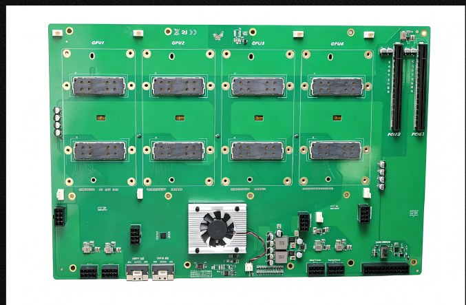
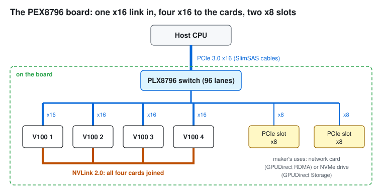
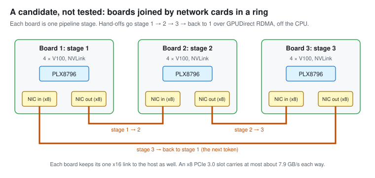

# A newer four-card V100 board: the PEX8796 switch board

*Research note, 2026-11-20. Gathered from the maker's specification sheet and Chinese marketplaces, video sites and
forums. **We have not bought or tested this board.** Everything about how it performs is the maker's figure, and
everything about what it could do for our builds is our reading, marked as such.*

Since mid-2026 a second kind of four-card SXM2 NVLink board is on sale from Chinese makers: green, with a PCIe switch
chip under a small fan in the middle of the board and two full-length PCIe slots on one edge. This note says what
the board is, translates what its maker says the switch and the two slots are for, and works out whether the board
gives a faster path between boards than the one our builds use. It does not; the slots can carry a different path.

## The board

| | |
|---|---|
| Maker | Shenzhen Suqiao Technology Co., Ltd. (深圳市速桥科技有限公司), brand "Speedbridge" (速桥) |
| Model | **SQ8796-4SXM2-NV**, "四路V100 SXM2算力底板" (four-way V100 SXM2 compute baseboard) |
| Switch | Broadcom **PLX8796 / PEX8796**, PCIe 3.0, 96 lanes, 24 ports ([Broadcom data sheet](https://docs.broadcom.com/doc/12351860)) |
| To the host | **one PCIe 3.0 x16** link from one CPU, over SlimSAS (SFF-8654) cables |
| To each V100 | PCIe 3.0 **x16** from the switch |
| Spare slots | **two PCIe 3.0 x8** slots, fed by the same switch |
| Between the four cards | NVLink 2.0, all four cards joined to each other (unchanged from the board we use) |
| Power | eight GPU 8-pin inputs; an ATX 24-pin input as a second source, chosen by a switch on the board |
| Specification sheet | 18 slides in Chinese, dated June 2026, on the [maker's product page](https://www.suqiao.cn/pd.jsp?id=61) ([PDF](https://4161853.s21i.faiusr.com/61/ABUIABA9GAAgyryI0gYoyKX-8QI.pdf)) |
| Price seen | US$716 for the board and US$761 for a kit with a PEX card and cables on Alibaba, November 20, 2026 |
| Where sold | [1688](https://detail.1688.com/offer/1102866256081.html), Taobao, [Alibaba](https://www.alibaba.com/product-detail/New-4-GPU-V100-SXM2-Switch_1601827637873.html) ([kit](https://chinese.alibaba.com/product-detail/New-V100-SXM2-4-GPU-Baseboard-1601824449969.html)), and under the PEX8796 name from other sellers ([example](https://www.alibaba.com/product-detail/4-SXM2-V100-GPU-Switch-Board_1601827764004.html)) |

*The board, from the maker's specification sheet (photo: Shenzhen Suqiao Technology). The four GPU sites are
across the top; the switch is under the fan; the two PCIe slots stand along the right edge.*

## How it differs from the board in our builds

| | The board in our builds | The PEX8796 board |
|---|---|---|
| Where the PCIe switch sits | In the host: PLX8749 switch cards in the host's x16 slots, cabled to the board | On the board itself |
| Link from each V100 to its switch | x8 | x16 |
| Links from one board to the host | two x16 on the eight-card builds (two switch cards per board, each in its own slot) | one x16 |
| Spare PCIe on the board | none | two x8 slots |
| NVLink | four cards, all joined | the same |

The board we use is the one sold as "V100 4-card Quad-GPU SXM2 300G NVLINK 300GB/s Interconnection Baseboard
Solution" ([hardware list](../../hardware.md#one-four-card-board)). Its silkscreen reads `YMZX-4GPU-Q1`. We read
"YMZX" as the initials of 一猫之下 (Yi Mao Zhi Xia), the company behind 1Cat-vLLM; that is our inference, not a
statement by the maker.

## What the maker says, translated

The quotations are from the specification sheet; the translations are ours.

**Slide 3, product overview.**

> 基于PLX8796 PCIe交换芯片开发，原生支持4张NVIDIA V100 SXM2显卡实现NVLINK 2.0全互联拓扑

"Built on the PLX8796 PCIe switch chip, it natively supports four NVIDIA V100 SXM2 cards in a fully connected NVLink
2.0 topology."

> 单CPU PCIe 3.0 x16接口输入，高效扩展多路GPU，最大化释放处理器的PCIe通道潜能。

"Input from a single CPU over one PCIe 3.0 x16 link, efficiently expanded to several GPUs, making the most of the
processor's PCIe lanes."

> 预留2路PCIe 3.0 x8插槽，可灵活外接高速网卡、SSD阵列卡或其他硬件加速卡，功能扩展性强。

"Two PCIe 3.0 x8 slots are reserved, so a high-speed network card, an SSD array card or another accelerator card can
be added."

**Slide 4, topology.**

> 信号由 CPU 引出，通过 PCIe 3.0 x16 高速通道直连 PLX8796 交换芯片 … 向下分配 4 路 PCIe 3.0 x16 给 V100 显卡，2 路 PCIe 3.0 x8 给扩展卡

"The signal leaves the CPU over a PCIe 3.0 x16 link straight to the PLX8796 switch … which hands out four PCIe 3.0
x16 links to the V100 cards and two PCIe 3.0 x8 links to expansion cards."

**Slide 6, what the x8 slots are for** (headed "丰富扩展性 - PCIe x8 插槽应用", "expansion: uses of the PCIe x8
slots"). Two uses, nothing else:

1. 高速网络扩展 (PCIe NIC), a high-speed network card:

   > 连接NVIDIA ConnectX等高性能网卡，构建低延迟、高吞吐的AI服务器集群，为分布式模型训练提供坚实的网络通信底座。

   "Connect an NVIDIA ConnectX or similar high-performance network card to build a low-latency, high-throughput AI
   server cluster: the network foundation for distributed model training."

   > 支持400Gb/s及更高带宽的RDMA网络 … 利用GPUDirect RDMA实现GPU间直接通信，显著减少CPU开销，加速All-Reduce等集体通信

   "Supports RDMA networks of 400 Gb/s and more … uses GPUDirect RDMA for direct communication between GPUs,
   substantially reducing CPU overhead and accelerating All-Reduce and other collective operations."

2. 高速存储缓存 (PCIe SSD), a fast NVMe drive as a local cache:

   > GDS技术加速数据加载：数据从SSD直达GPU显存

   "GDS (GPUDirect Storage) speeds up data loading: data goes from the SSD straight into GPU memory."

**Slide 7, power.** Mode one (the default) feeds the four cards from a separate high-power supply through the eight
GPU 8-pin inputs, "for 2,000 W and larger GPU power supplies". Mode two adds an ATX supply through the 24-pin input,
switched on with the board's DIP switch, "when the supply is small, for long full-load runs, or when several PCIe
devices (an SSD array, network cards) are added".

So the switch is there so that one x16 link from one CPU serves all four cards with no motherboard bifurcation and
no separate switch card, and the two slots are there so that a network card or a drive sits under the same switch
as the GPUs. The sheet presents the board as a building block for a cluster of machines joined by RDMA networking.
It says nothing about joining two boards to each other over PCIe.

## The maker's measurements (slides 9 and 10)

Test machine: AMD EPYC 7K62, Ubuntu 22.04, NVIDIA driver 570, CUDA 12.4.

| Test | Result |
|---|---|
| NCCL `all_reduce_perf -b 1m -e 8g -f 2 -g 4`, bus bandwidth | 97.3 GB/s average, 123.4 GB/s peak |
| GPU to GPU over NVLink | 48.48 GB/s one way, 96.9 GB/s both ways |
| Host to GPU / GPU to host | 13.1 GB/s / 13.5 GB/s |
| Within one card's memory | 779.2 GB/s |

The NVLink figures are what any four-card NVLink board gives; the switch does not change them. The host figures are
one x16 PCIe 3.0 link (about 15.75 GB/s in theory each way), shared by all four cards.

## What others are doing with more than one board

- **1Cat's company** (一猫之下科技, on Bilibili) ran DeepSeek V4.1 Flash on 16 V100s in four Dell C4140 servers
  joined by a 40 Gb network and reported 203 tokens per second, describing it as 1Cat-vLLM's multi-machine
  parallelism ([video, 2026-11-12](https://www.bilibili.com/video/BV12YWd6hEnp/)). Their path between groups of four
  cards is the network, not PCIe.
- **ShuMeng AI Server** (数萌) announced a water-cooled four-card V100 NVLink system "flexibly expandable to 16 cards"
  ([video, 2026-09-22](https://www.bilibili.com/video/BV1gqhE6UE5L/)); the page does not say how.
- **A Level1Techs thread** on designing an open four-card backplane works through the same question and concludes
  that with switch boards the traffic between boards is capped by each board's one x16 link to the host
  ([thread, May 2026](https://forum.level1techs.com/t/designing-an-open-source-budget-4x-v100-sxm2-nvlink-backplane-passive-pcie-vs-pex8749/250801)).

## Does it give a faster path between boards?

*Our reading. Not measured.*

**Over PCIe, no.** PCIe is a tree: every device has one path up to the CPU, and links cannot be joined into a ring.
With two of these boards, traffic from a card on one board to a card on the other goes card → switch → x16 cable →
CPU → x16 cable → switch → card, and each board has one x16 link where the eight-card builds give each board two.
Two of these boards behind one bigger host switch, as the twelve-card build seats two boards behind one PLX88096
card, would keep that traffic off the CPU, but still through one x16 link per board.

**It matters less than it looks for how our builds work.** Every build keeps tensor parallelism inside a board and
cuts the model into one pipeline stage per board ([part 1](../../index.md#part-1-voltas-architecture)), so what
crosses between boards is the hand-off between stages. The twelve-card design puts that hand-off at 41 to 50 KB per
token per hop; in decode the time is per-transfer latency (estimated at about 35 µs a transfer), not bandwidth
([design note](../volta/deepseek-v4.1-flash/PORT_DESIGN.md)). Giving every switch card its own x16 slot was worth
about 2 % on long-prompt first token and nothing on decode
([decision table](../../method/decision-table.md)). A board with less host bandwidth would therefore change little
for these builds. Two things could be worse with it: a build that reads expert weights from host memory (the cards
do this at 3.5 to 4.9 GB/s each today) would share one x16 link among four cards, and loading a model would take
longer.

**The slots offer a different path: a network card on each board.** Put a ConnectX card in a board's x8 slot and
traffic can go card → switch → network card → cable → network card → switch → card with GPUDirect RDMA, never
touching the CPU. A pipeline is already a loop: stage 1 hands to stage 2, stage 2 to stage 3, and the last stage's
token goes back to stage 1. With two network ports per board (both slots, or one two-port card) the boards could be
cabled in exactly that ring.

What that would and would not give, as we read it:

- **Bandwidth.** One x8 PCIe 3.0 slot carries about 7.9 GB/s each way in theory, so a network card in it cannot pass
  more than that, whatever its port speed. Two slots per board come to about the same as the board's one host link.
  The gain is a second path in addition to the host link, not a faster one.
- **Latency.** In decode the hand-off is small and its cost is per-transfer latency. Whether an RDMA hop beats the
  current PCIe hand-off is the thing to measure first.
- **Scale.** The real use is the one the maker describes and 1Cat demonstrated: boards in separate cheap hosts joined
  by network cards, so a build is not limited to the boards one host can seat. The hand-off is small enough for a
  network to carry it.
- **What it needs.** A ConnectX card per board (or two), GPUDirect RDMA working on the host (the `nvidia-peermem`
  module), access control (ACS) off on the switch path so peer traffic is allowed, and an engine that runs each
  board as its own node: NCCL inside one machine normally moves data over PCIe or shared memory, and uses the
  network only between nodes. 1Cat-vLLM's multi-machine mode is the starting point.

## What we would test before buying several

1. One board: the maker's NCCL and bandwidth tests, plus our own long-prompt and decode figures against the same
   cards on the board we use now.
2. Host-memory reads from four cards at once through the one x16 link, against today's figure of 3.5 to 4.9 GB/s a
   card.
3. Two boards, two network cards: the stage hand-off over GPUDirect RDMA against the same hand-off over PCIe, both
   latency per transfer and time to first token on a long prompt.
4. Only then a three-board ring.

## Sources

- Speedbridge product page and specification sheet: https://www.suqiao.cn/pd.jsp?id=61 ·
  [PDF](https://4161853.s21i.faiusr.com/61/ABUIABA9GAAgyryI0gYoyKX-8QI.pdf)
- 1688 listing (PLX8796, PCIe 3.0 x16 to four SXM2): https://detail.1688.com/offer/1102866256081.html
- Alibaba listings: https://www.alibaba.com/product-detail/New-4-GPU-V100-SXM2-Switch_1601827637873.html ·
  https://chinese.alibaba.com/product-detail/New-V100-SXM2-4-GPU-Baseboard-1601824449969.html ·
  https://www.alibaba.com/product-detail/4-SXM2-V100-GPU-Switch-Board_1601827764004.html
- Broadcom PEX8796 data sheet: https://docs.broadcom.com/doc/12351860
- 1Cat multi-machine video: https://www.bilibili.com/video/BV12YWd6hEnp/
- ShuMeng "expandable to 16 cards": https://www.bilibili.com/video/BV1gqhE6UE5L/
- Level1Techs thread: https://forum.level1techs.com/t/designing-an-open-source-budget-4x-v100-sxm2-nvlink-backplane-passive-pcie-vs-pex8749/250801
